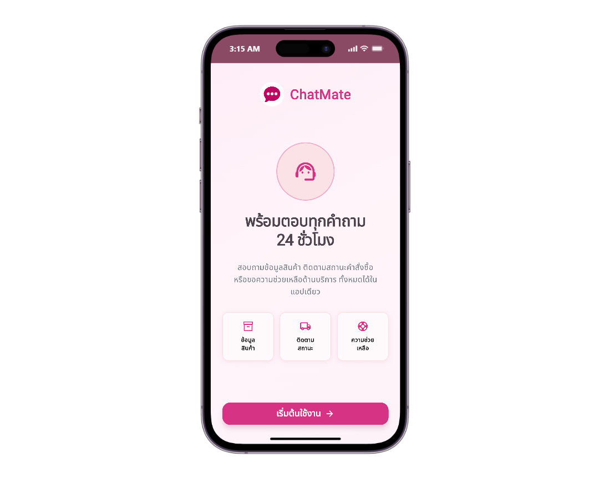
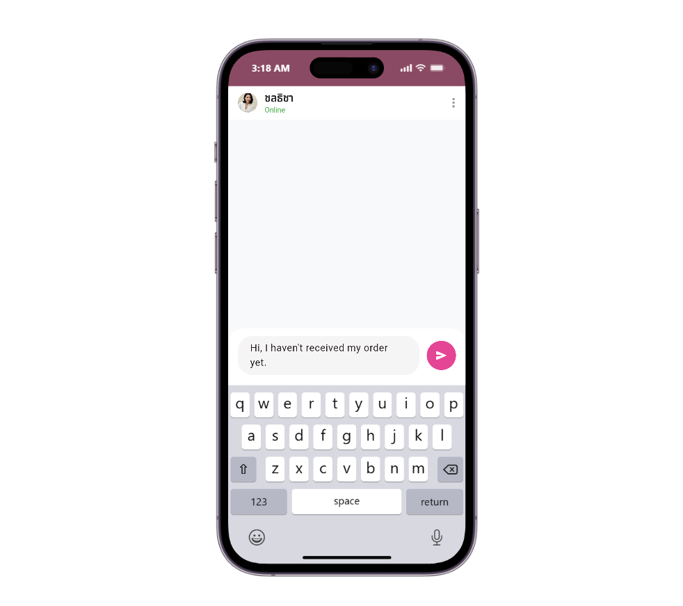
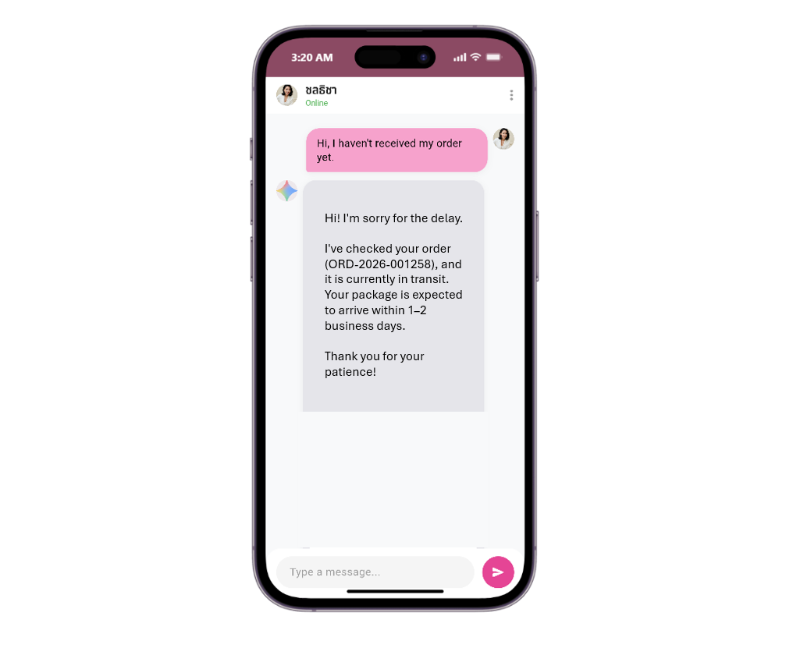
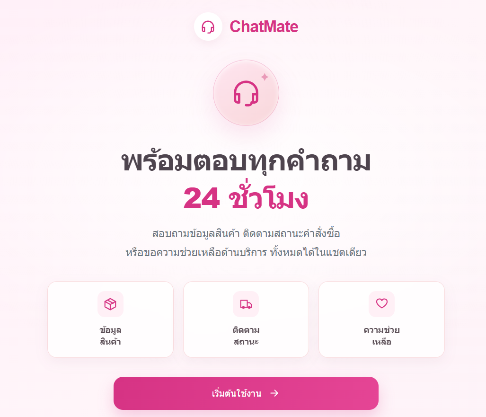
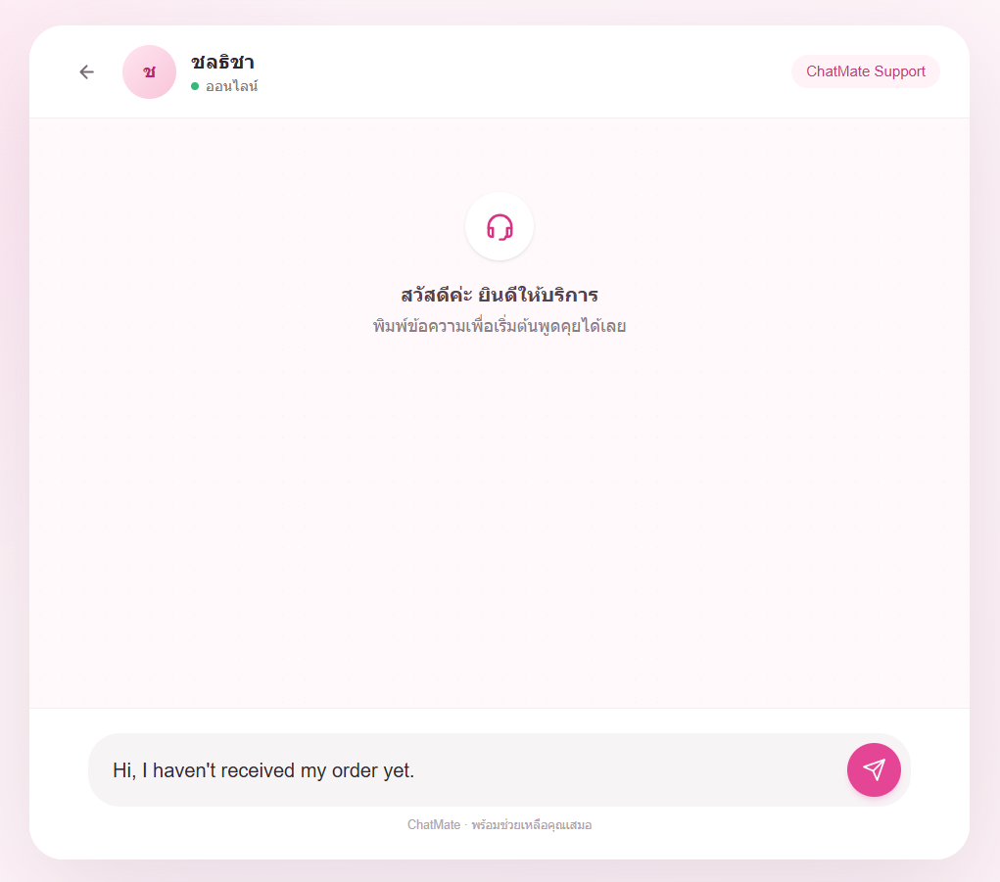
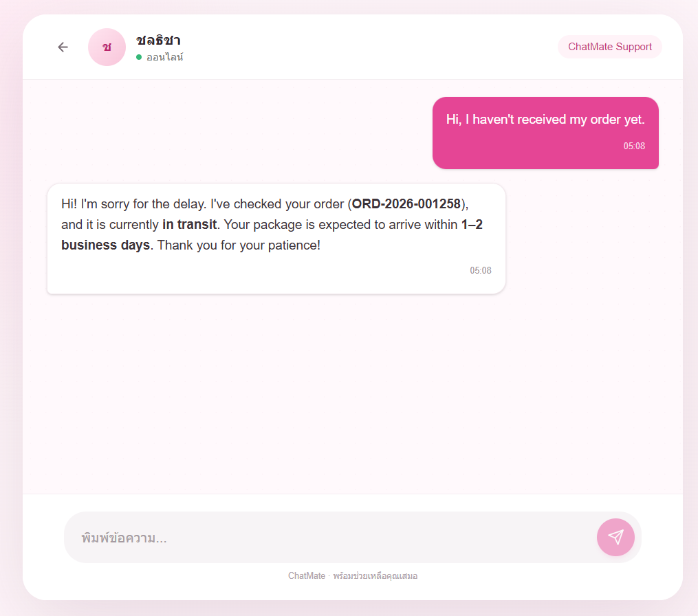

# ChatMate

ChatMate is an AI-powered chat system. Its FastAPI backend connects to the Gemini API and stores chat history in MySQL. Users can access the system through a Flutter mobile application or a Next.js web application.

## Screenshots

All screenshots use the same display dimensions.

### Mobile Application

#### Welcome



#### Chat



#### Chat result



### Web Application

#### Welcome



#### Chat



#### Chat result



## System Overview

```text
Flutter Mobile ─┐
                ├── REST: chat history
Next.js Web ────┤
                └── WebSocket: send and receive messages
                         │
                         ▼
                   FastAPI Backend
                    │           │
                    ▼           ▼
                  MySQL      Gemini API
```

## Features

- Chat with an AI assistant from Flutter or a web browser
- Send messages and receive AI responses over WebSocket
- Store chat history in MySQL and retrieve it through a REST API
- Render AI responses as Markdown
- Configure the Flutter app and web client with `.env` files

> The backend currently uses the Gemini API for AI responses. Processing non-text messages is not implemented.

## Tech Stack

| Component | Technology | Purpose |
|---|---|---|
| Mobile | Flutter, Dart | Client application for supported Flutter platforms |
| Web | Next.js 16, React 19, TypeScript | Web chat interface |
| Web styling | Tailwind CSS 4 | Web interface styling |
| API | Python, FastAPI, Uvicorn | REST and WebSocket services |
| AI | Google Gen AI SDK (`google-genai`) | Generate responses with Gemini |
| Database | MySQL, `mysql-connector-python` | Store customer and chat data |
| Mobile local storage | SQLite (`sqflite`) | Local storage for the Flutter app |
| Markdown | `react-markdown`, `flutter_markdown` | Render formatted AI responses |

The web application does not use SQLite; it retrieves chat history from the backend API.

## Project Structure

```text
chatmate/
├── backend/
│   ├── fastapi/
│   │   ├── main.py                 # FastAPI REST/WebSocket API and Gemini integration
│   │   ├── requirements.txt        # Python dependencies
│   │   └── .env.example            # Example backend configuration
│   └── mysql/
│       └── chatdb.sql              # MySQL schema dump
├── frontend/
│   ├── flutter/
│   │   ├── lib/                    # Flutter application source
│   │   ├── assets/                 # Images and other assets
│   │   ├── pubspec.yaml            # Flutter dependencies
│   │   └── .env.example            # Example API host and port
│   └── nextjs/
│       ├── src/app/                # Welcome and chat pages
│       ├── public/                 # Web static assets
│       ├── package.json            # Scripts and dependencies
│       └── .env.example            # Example backend API URL
├── docs/
│   └── screenshots/                # Screenshots used in this README
└── README.md
```

## Requirements

- Python 3.12 or later, with support for the pinned Python packages
- MySQL 8.0 or later
- Node.js 20.9 or later and npm
- Flutter SDK with Dart 3.7 or later
- A Gemini API key
- A network-reachable backend IP address when running Flutter on a physical device

## Setup and Run

Set up MySQL and the FastAPI backend before starting either client.

### 1. Configure MySQL

Create a `chatdb` database and import the schema from `backend/mysql/chatdb.sql`. Before importing, note that the SQL dump drops and recreates the `chat_messages` table; back up any data you need to keep. Review the sample customer data in the dump and replace it as appropriate before using it in production.

You can open and run the SQL file in MySQL Workbench after selecting the `chatdb` database. Configure the database connection values in the backend `.env` file.

### 2. FastAPI Backend

```powershell
cd backend\fastapi
Copy-Item .env.example .env
```

Set your Gemini API key and MySQL connection details in `.env`:

```env
GEMINI_API_KEY=your_gemini_api_key
DB_HOST=localhost
DB_USER=root
DB_PASSWORD=your_mysql_password
DB_NAME=chatdb
HOST=0.0.0.0
PORT=8000
MODEL=gemini-2.5-flash
```

Set `MODEL` to a model available to your Gemini API key. Keep API keys and passwords in `.env`; do not commit this file or publish its contents.

Install the dependencies and start the backend:

```powershell
python -m venv .venv
.\.venv\Scripts\Activate.ps1
pip install -r requirements.txt
python main.py
```

By default, the backend listens on `http://localhost:8000`. Configure `HOST` and `PORT` in `.env` to change the bind address or port.

### 3. Flutter Mobile Application

Open a new terminal:

```powershell
cd frontend\flutter
Copy-Item .env.example .env
```

Set the backend host and port in `frontend/flutter/.env`:

```env
HOST=192.168.1.101
PORT=8000
```

On a physical phone, `localhost` refers to the phone itself. Use the computer's LAN IP address when the backend runs on another device. Make sure both devices are on the same network and that the firewall allows connections to port 8000.

```powershell
flutter pub get
flutter devices
flutter run
```

Flutter's SQLite data is stored locally. Running Flutter Web in a browser requires a compatible `sqflite` platform implementation; the Next.js application is the web client that does not use SQLite.

### 4. Next.js Web Application

Open a new terminal:

```powershell
cd frontend\nextjs
Copy-Item .env.example .env
```

Set the backend HTTP origin reachable from the browser in `frontend/nextjs/.env`:

```env
NEXT_PUBLIC_API_URL=http://192.168.1.101:8000
```

```powershell
npm install
npm run dev
```

Open [http://localhost:3000](http://localhost:3000). The WebSocket URL is derived from `NEXT_PUBLIC_API_URL`, so the backend must be reachable from the device running the browser. To build and run the production version:

```powershell
npm run build
npm run start
```

## API Reference

### `GET /api/chat/history/{customer_id}`

Returns the chat history for a customer.

```powershell
curl http://localhost:8000/api/chat/history/1
```

The response is an array of messages. Each message contains `id`, `message_type`, `content`, `is_from_user`, and `created_at`.

### `WS /ws/{client_id}`

Send messages and receive AI responses over a WebSocket connection. The client sends a JSON object:

```json
{
  "message_type": "text",
  "content": "Hi, I haven't received my order yet."
}
```

The server response contains `id`, `message_type`, `content`, `is_from_user`, and `created_at`. The server ignores messages that are not valid JSON objects with the required fields.

## Notes

- The web and Flutter demos currently use customer ID `1`. This is not authentication; user sign-in and authorization have not been implemented.
- The backend currently allows requests from all CORS origins. Restrict allowed origins before deploying to production.
- Keep Gemini API keys and database passwords in `.env` files, and never commit them to the repository.
- Importing `chatdb.sql` drops and recreates the existing `chat_messages` table.
